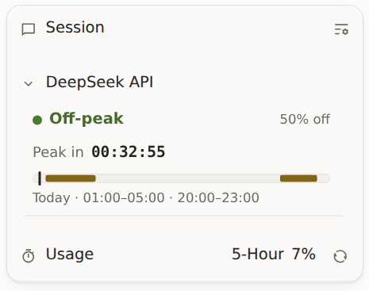
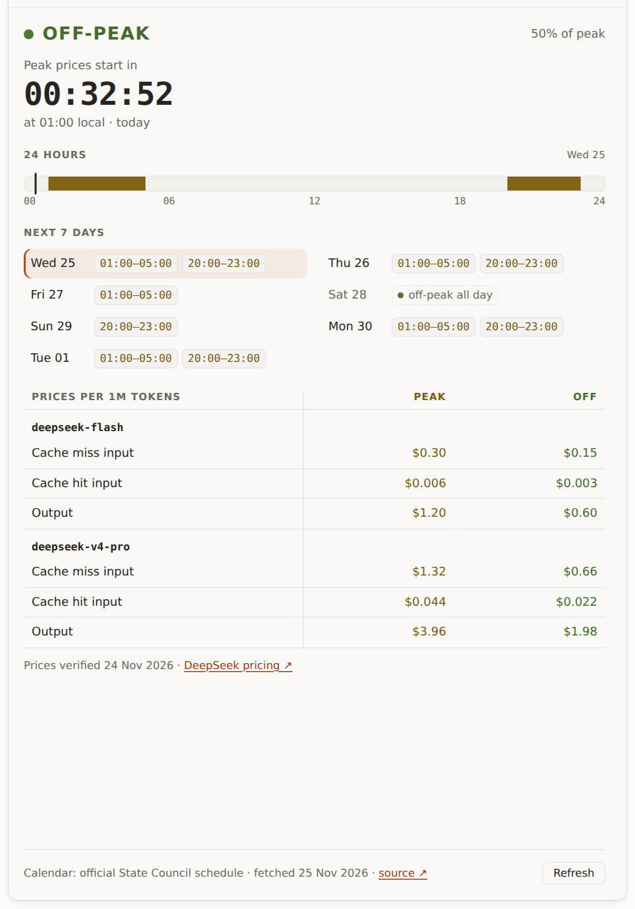

# DeepSeek API Hours

An OpenChamber extension that shows whether DeepSeek API prices are at peak or off-peak, when the next switch happens, and what it costs. It ships two surfaces:

- **Work Status section** (`DeepSeek API`): a compact state row, countdown, 24-hour local ribbon, and today's peak windows.
- **Rail panel** (`DeepSeek API Hours`, also available on the phone): the full state header, local 24-hour timeline, the next 7 local days, and the price table.

There is no service, no OpenCode plugin, and no capability beyond the three network origins used for the holiday calendar.





## Install

Paste this into **Settings → Extensions → Folder, ZIP, or URL**:

```
https://github.com/AlessandroZamai/openchamber-deepseek-hours
```

The extension requests one permission: network access to the three calendar origins. Approve it in the dialog. Updates appear on the extension card when this repository changes.

To run from a folder instead:

```bash
npm install --no-audit --no-fund
npm run build
```

Then add the folder in **Settings → Extensions**. Folder installs run straight from the folder, so after editing run `npm run build` again and reload the extension. The install only needs `package.json`, the two HTML shells, the built `main.js`/`styles.css` in `panel/` and `status/`, and `README.md`; `node_modules/` and `build/` are not part of an install.

## Schedule rules

- Peak: Monday–Friday, 01:00–04:00 and 06:00–10:00 UTC, end-exclusive.
- Everything else is off-peak, and off-peak prices are exactly half of peak prices.
- Weekends by UTC date are off-peak. The 7-day list labels rows by local date, so a UTC-Monday 01:00 window can appear on a local Sunday evening.
- Chinese public holidays are off-peak for the entire official break. The date is determined in `Asia/Shanghai` and checked against the fetched off-day set. No holiday dates are hardcoded in the extension.

Peak evaluation order is: Beijing holiday → UTC weekend → UTC peak window.

If no calendar source can be reached and no cached copy exists, the extension falls back to the Mon–Fri rule and says so in the UI (`Holiday calendar unavailable — showing Mon–Fri peak hours only`).

## Holiday calendar sources

The calendar is fetched at runtime and cached in `host.storage` per year under `deepseek-hours.calendar.v1.<year>`. Each year is cached for 24 hours; a “not published yet” answer is cached for 6 hours. A cached copy renders immediately while a background refresh runs (stale-while-revalidate).

Sources are tried in this order:

1. **holiday-cn on raw.githubusercontent.com** — `https://raw.githubusercontent.com/NateScarlet/holiday-cn/master/<year>.json`
2. **holiday-cn on jsDelivr** — `https://cdn.jsdelivr.net/gh/NateScarlet/holiday-cn@master/<year>.json?v=YYYYMMDD`
3. **chinese-days on unpkg** — `https://unpkg.com/chinese-days@2/dist/years/<year>.json`

The third source is an independent dataset (repo [`vsme/chinese-days`](https://github.com/vsme/chinese-days)), not another mirror of holiday-cn. Its `holidays` object keys are normalized into off days; `workdays` is ignored because weekends are already off-peak. For chinese-days, the source link is the GitHub repository rather than a State Council paper.

The footer names the dataset that actually served the current year: `Calendar: official State Council schedule` for holiday-cn, `Calendar: chinese-days backup` for the backup source. It only claims an official State Council calendar when the current year's data actually came from holiday-cn; otherwise it says the calendar is loading or unavailable.

A source that returns a non-2xx status, invalid JSON, or fails validation is skipped. Three 404s mean the year is not published yet. Any other total failure keeps the cached copy and marks it stale.

The extension refreshes the calendar on its own: every 60 seconds while the current year's calendar is unusable, and every 6 hours otherwise. A fresh “not published yet” answer is honored for 6 hours, so the 60-second retry only starts real requests once that cache expires or you press Refresh. This also picks up the next year's calendar once it is published. The panel's **Refresh** button bypasses the TTL immediately, fetches all sources again, and shows a toast with the outcome. The compact section only warns when the *current* Beijing year is unusable; a missing next year is a muted note in the panel instead.

## Prices

`PRICES` and `PRICES_VERIFIED` live in [`src/schedule.js`](src/schedule.js). Prices are USD per 1M tokens and are checked against [DeepSeek's pricing page](https://api-docs.deepseek.com/quick_start/pricing); the panel links to it.

To update prices:

1. Edit the `PRICES` entries for `deepseek-flash` and `deepseek-v4-pro` (cache hit input, cache miss input, output; peak and off-peak).
2. Set `PRICES_VERIFIED` to the verification date (`YYYY-MM-DD`).
3. Run `npm run build`.

The price table is generated from these constants; there is no second copy in the HTML.

## Develop

```bash
npm install
npm test        # TZ=America/Toronto node --test test/*.test.js
npm run build   # esbuild bundle → build/, then copy to panel/ and status/
```

`src/schedule.js` is pure scheduling/pricing logic with no imports. `src/calendar.js` takes its storage, fetch, and clock via injection so tests never touch the network. `test/fixtures/` holds official 2027 calendar snapshots used by the tests; production code never reads them.

The bundle is a classic IIFE because the extension iframe cannot load ES modules. Both HTML shells load the same `main.js`, which chooses the compact or full renderer from `ctx.surface` (`status` vs `panel`/`dialog`/`page`).

The UI uses only `--oc-*` host theme tokens, so it follows OpenChamber's light and dark themes and the phone layout.

## License

MIT — see [LICENSE](LICENSE).
